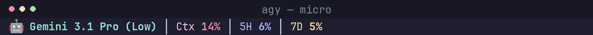
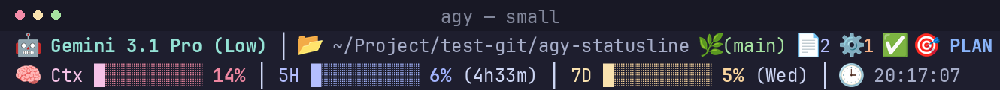
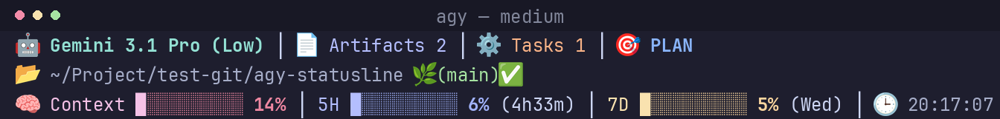
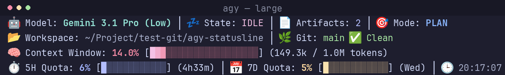
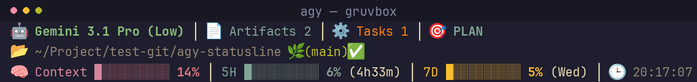

# Antigravity CLI Statusline

A themeable statusline for [Antigravity CLI](https://antigravity.google/) (`agy`): model, permission mode, git status, context window, and usage quota, all at a glance. 4 sizes, 5 themes, auto-shrinks to fit narrow terminals.






## Install

```bash
curl -fsSL https://raw.githubusercontent.com/Hadisd/agy-statusline/main/install.sh | bash
```

The installer asks for size, theme, and effort style. Or skip the prompts by
specifying all three directly:

```bash
curl -fsSL https://raw.githubusercontent.com/Hadisd/agy-statusline/main/install.sh | bash -s -- medium dracula bars
```

Or from a local clone:

```bash
git clone https://github.com/Hadisd/agy-statusline.git && cd agy-statusline
bash install.sh                       # choose size, theme, and effort style
bash install.sh medium dracula bars   # or specify all three directly
```

Restart `agy` afterward. Re-running swaps the previous install (settings backed up automatically).

**Themes:** `mocha` (default), `tokyo-night`, `nord`, `dracula`, `gruvbox`. They recolor everything, including the quota gradient bars.



## Sizes

| Size | Lines | Shows |
|---|---|---|
| `micro` | 1 | Model + Ctx/5H/7D % only |
| `small` | 2 | Compact layout, key info |
| `medium` | 3 | Balanced layout with brand, state, path & quota |
| `large` | 4 | Full detail: token numbers & quota bars |

**Auto-shrinks** large→medium→small→micro if the terminal's too narrow (heuristic, via `/dev/tty`). Disable with `--no-autoshrink` / `AGY_STATUSLINE_NO_AUTOSHRINK=1`.

## What it shows

🤖 model · 🎯 permission mode (plan/accept-edits) · 📂 path · 🌿 git branch + dirty status · 📄/⚙️ artifact & task counts · 🧠 context window · 5H/7D quota bars (scoped to the active model's group) · ⚠️ once any of those crosses 90%.

Argon models show `🔥` after the name in every size, for example
`Gemini 4 Argon 🔥 ●●○`.

Choose an effort style during installation:

| Style | Low | Medium | High |
|---|---|---|---|
| `original` | `(Low)` | `(Medium)` | `(High)` |
| `dots` (default) | `●○○` | `●●○` | `●●●` |
| `bars` | `▰▱▱` | `▰▰▱` | `▰▰▰` |
| `minimal` | `L` | `M` | `H` |

Your choice is saved in the installed wrapper. Set `AGY_STATUSLINE_EFFORT_STYLE`
to override it; `text` also works as an alias for `original`. Models without
these effort labels keep their names. Older install commands that omit the
style use dots when run without an interactive terminal.

The Git segment in `small`, `medium`, and `large` shows upstream differences:
`↑2 ↓1` means two commits to push and one to pull. Counts use the upstream
history from your last fetch; zero counts and branches without an upstream
show no arrows.

Quota bars show **used** quota. For example, `/usage` reporting 69% remaining
corresponds to 31% used in the statusline. Argon's separate weekly bucket is
selected on Pro plans; a missing 5H limit displays `N/A`.

The statusline runs `agy -p /usage` in the background every 60 seconds because
the interactive session can keep sending stale quota values. This uses the CLI's
existing login and built-in quota command. The prompt draws immediately while
the refresh runs. Cached values older than two minutes show `⌛`; an unavailable
quota displays `N/A`, rather than a false zero. `agy` must be on `PATH`.

Set `AGY_STATUSLINE_LIVE_QUOTA=0` to use only the session's input. To refresh the
cache immediately, run `python3 scripts/statusline_engine.py --refresh-quota`.

No Nerd Font needed: every glyph is a standard emoji/Unicode block.

## Requirements

`python3` (usually preinstalled) and `jq` (auto-installed by the installer if missing).

## Development

`python3 scripts/statusline_engine.py --selftest` renders every size × theme combo against a few sample payloads and reports failures.

`python3 -m unittest discover -s tests -v` checks Git sync indicators, installer
choices, quota selection, and background refresh using temporary local repos,
config directories, and a stand-in for the external `agy` command.

## Uninstall

Remove `statusLine` from `~/.gemini/antigravity-cli/settings.json` (backup exists from install) and delete `statusline.sh` + `statusline_engine.py` from that same directory.

## Thanks

Forked from [AwesomeJun/CC-statusline](https://github.com/AwesomeJun/CC-statusline) and rewritten for Antigravity's own (undocumented) statusline payload. Thanks to [AwesomeJun](https://github.com/AwesomeJun) for the original layout and installer design this was built on.
